# Campus 360 Impact Map (IMPACT-MAP.md)

> **Document Version:** 1.0.0  
> **Last Verified Date:** 2026-11-06  
> **Project Target:** Campus 360 (NKOCET Solapur)  
> **Repository Architecture:** Layered Domain-Driven Client (Vite + React + TypeScript + Supabase + TanStack Query)

---

## 1. Purpose

The Campus 360 platform connects students, faculty advisors, club coordinators, and institutional administrators across events, certificates, news, recruitments, campus maps, and governance workflows.

### Why this document exists:
1. **Prevent Cascading Regressions**: A change to a single client configuration, database table, or shared hook can cascade across multiple views, offline fallback mechanisms, and security boundaries.
2. **Bridge the Dual-Engine Architecture**: Campus 360 features a dual runtime: live Supabase cloud database with Row Level Security (RLS) policies and PostgreSQL functions, paired with an offline mock and `localStorage` fallback layer. Altering one without accounting for the other causes split-brain state.
3. **Enforce Security & Privacy Boundaries**: Institutional data (student PRNs, phone numbers, audit logs, and certificate records) must strictly conform to role-based access rules and public verification boundaries.
4. **Guide Engineers & AI Assistants**: Before modifying, refactoring, or extending any file, function, schema, or configuration, engineers and AI assistants **must** consult this map to trace direct and indirect downstream impacts.

---

## 2. Impact Map

### 2.1 Configuration & Core Client Foundation

#### `src/config/env.ts`
- **Description**: Central type-safe parser for environment variables (`VITE_*`) with fallbacks.
- **Direct Dependencies**:
  - Consumed by: `src/lib/supabase.ts`, `src/api/client.ts`, `src/api/services/auth.service.ts`, `src/config/index.ts`.
  - Directly depends on: `import.meta.env`.
- **Indirect Dependencies**:
  - Every service, page, and hook depends on `env` through Supabase client initialization and API base URLs.
- **API Impact**:
  - `apiBaseUrl` sets the root prefix for all REST fallback requests.
  - `siteUrl` governs auth redirect destinations (email confirmation, password resets) and QR verification base URLs.
- **Data Impact**:
  - Misconfiguration of `supabaseUrl` or `supabaseAnonKey` triggers silent fallback to offline mock mode.
- **Auth / Security Impact**:
  - An incorrect `siteUrl` (e.g. `localhost` on mobile) causes email confirmation redirects to fail.
- **Runtime Impact**:
  - Modifying `mockLatencyMs` alters network simulation timing in mock mode.
- **Test & Deployment Impact**:
  - Touches `render.yaml`, `.env`, `.env.example`, and CI/CD secret provisioning.

#### `src/config/constants.ts`
- **Description**: Central immutable catalog of route paths (`ROUTES`), user roles (`USER_ROLES`), storage keys (`STORAGE_KEYS`), event categories, and labels.
- **Direct Dependencies**:
  - Consumed by: `src/App.tsx`, `src/components/layout/shell.tsx`, `src/components/layout/sidebar-link.tsx`, `src/context/auth-context.tsx`, `src/api/client.ts`, `src/pages/**`.
  - Directly depends on: none (pure constants).
- **Indirect Dependencies**:
  - Route navigation throughout all components (`Link href={ROUTES.*}`); role guards and badge styling.
- **API Impact**:
  - Modifying `STORAGE_KEYS` breaks active user session token retrieval in `client.ts` (`STORAGE_KEYS.AUTH_TOKEN`).
- **Data Impact**:
  - Changing `USER_ROLES` values breaks database enum compatibility (`public.user_role`).
- **Auth / Security Impact**:
  - Role string alterations (`student`, `faculty`, `coordinator`, `admin`) break permission checks across the UI and RLS database policies.
- **Runtime Impact**:
  - Route path changes without matching updates in `src/App.tsx` result in 404 Not Found views.
- **Test & Deployment Impact**:
  - Checked by `scripts/test-all-features.js` and all routing tests.

#### `src/lib/supabase.ts`
- **Description**: Supabase client singleton, connection validator (`isSupabaseConfigured()`), and typed database gateway.
- **Direct Dependencies**:
  - Consumed by: `src/context/auth-context.tsx`, `src/api/services/*.ts`, `src/hooks/use-notifications.ts`, `src/lib/storage.ts`.
  - Directly depends on: `@supabase/supabase-js`, `src/config/env.ts`, `src/types/database.ts`.
- **Indirect Dependencies**:
  - Every user-facing feature with live persistence relies on this singleton.
- **API Impact**:
  - Bypasses traditional REST endpoints, directly communicating with Supabase PostgREST, Auth GoTrue, and Storage APIs.
- **Data Impact**:
  - Schema types defined in `src/types/database.ts` constrain all database queries.
- **Auth / Security Impact**:
  - Configures `persistSession: true`, `detectSessionInUrl: true`, and custom token storage key `campus360.supabase.auth.token`. Never expose service role keys here.
- **Runtime Impact**:
  - If `isSupabaseConfigured()` returns `false`, all services branch into local mock fallback.
- **Test & Deployment Impact**:
  - Requires valid `VITE_SUPABASE_URL` and `VITE_SUPABASE_ANON_KEY` in deployment environment.

#### `src/api/client.ts`
- **Description**: Centralized HTTP client (`apiClient`), custom `ApiError` class, token interceptor, and comprehensive offline mock fallback handler (`handleMockFallback`).
- **Direct Dependencies**:
  - Consumed by: `src/api/services/*.ts`, `src/lib/api-client-react.ts`.
  - Directly depends on: `src/config/env.ts`, `src/config/constants.ts`, `src/data/landing-data.ts`.
- **Indirect Dependencies**:
  - All services when running in mock mode or when Supabase table queries fail.
- **API Impact**:
  - Defines the fallback JSON response contracts for `/api/auth/me`, `/api/events`, `/api/clubs`, `/api/news`, `/api/certificates`, etc.
- **Data Impact**:
  - Serves static seed records from `landing-data.ts`. Changes here affect offline demo presentations.
- **Auth / Security Impact**:
  - Injects `Authorization: Bearer <token>` into outgoing HTTP requests when auth token exists.
- **Runtime Impact**:
  - Catches fetch errors and serves mock responses without crashing the UI when `enableMockFallback` is true.
- **Test & Deployment Impact**:
  - Provides offline stability during preview deployments and local development without database access.

---

### 2.2 Authentication, Authorization & User Session

#### `src/context/auth-context.tsx` & `src/hooks/use-auth.ts`
- **Description**: Global React context provider managing user session, active role, auth lifecycle (login, signup, logout, role switching), and profile refreshes.
- **Direct Dependencies**:
  - Consumed by: `src/App.tsx`, `src/components/layout/shell.tsx`, `src/components/layout/user-menu.tsx`, `src/pages/**`.
  - Directly depends on: `src/api/services/auth.service.ts`, `src/lib/supabase.ts`, `src/config/constants.ts`, `src/types/auth.ts`.
- **Indirect Dependencies**:
  - Role-based UI visibility across all views (e.g. showing "Admin Console" or "Coordinator Hub" buttons in navigation).
- **API Impact**:
  - Calls `authService.getMe()`, `authService.login()`, `authService.signup()`, and `authService.logout()`.
- **Data Impact**:
  - Reads and writes to `localStorage` (`campus360_user`, `token`, `demo_role`).
- **Auth / Security Impact**:
  - Listens to `supabase.auth.onAuthStateChange` to synchronize session state across browser tabs.
  - Listens to browser `campus360_role_changed` CustomEvent to elevate or downgrade user privileges dynamically without full page reload.
- **Runtime Impact**:
  - State changes trigger re-renders of the top-level `AppShell` and child components.
- **Test & Deployment Impact**:
  - Top-level provider in `src/App.tsx`; breakage renders the entire application blank or inaccessible.

#### `src/api/services/auth.service.ts`
- **Description**: Authentication business logic, Supabase GoTrue calls, profile table sync (`public.profiles`), password resets, and fallback credentials.
- **Direct Dependencies**:
  - Consumed by: `src/context/auth-context.tsx`, `src/lib/api-client-react.ts`.
  - Directly depends on: `src/lib/supabase.ts`, `src/api/client.ts`, `src/config/env.ts`, `src/types/auth.ts`.
- **Indirect Dependencies**:
  - User registration, login redirect flows, profile avatar updates.
- **API Impact**:
  - Calls Supabase `auth.signInWithPassword`, `auth.signUp`, `auth.signOut`, `auth.resetPasswordForEmail`, `auth.updateUser`.
- **Data Impact**:
  - Queries and updates `public.profiles` (`full_name`, `avatar_url`, `department`, `year_of_study`, `roll_number`, `division`, `phone`).
- **Auth / Security Impact**:
  - Enforces designated super-admin email recognition (`sufiyannnn7@gmail.com`, `admin@nkocet.ac.in`, `vidapvinayak@gmail.com`).
  - Sets redirect URL for auth verification emails via `getAuthRedirectUrl(path)`.
- **Runtime Impact**:
  - Caches authenticated user in `localStorage` (`campus360_user`) for instant offline hydration.
- **Test & Deployment Impact**:
  - Must align with Supabase Auth Site URL and Redirect URL whitelist.

---

### 2.3 Coordinator Hub & Administrative Governance

#### `src/api/services/coordinator.service.ts`
- **Description**: Domain service managing coordinator workspaces, club profiles, meetings, team members, role elevation requests, and admin approvals.
- **Direct Dependencies**:
  - Consumed by: `src/pages/coordinator/**`, `src/pages/dashboard.tsx` (Admin Console), `src/components/layout/shell.tsx`.
  - Directly depends on: `src/lib/supabase.ts`, `src/lib/storage.ts`, `src/types/coordinator.ts`, `src/types/database.ts`.
- **Indirect Dependencies**:
  - Role elevation state changes trigger `campus360_role_changed` and `campus360_new_notification` events.
  - Admin approvals dispatch `campus360_club_approval_changed` events.
- **API Impact**:
  - Executes RPC functions:
    - `submit_role_elevation_request`
    - `get_pending_role_requests`
    - `resolve_role_elevation_request`
  - Manages REST/table calls to `public.clubs`, `public.approval_requests`, `public.club_coordinator_assignments`, `public.club_team_members`, `public.club_faqs`, `public.club_achievements`.
- **Data Impact**:
  - Manages `public.approval_requests` lifecycle (`pending` -> `approved` / `rejected`).
  - Directly alters `public.profiles.role` upon elevation approval.
  - Creates coordinator links in `public.club_coordinator_assignments`.
- **Auth / Security Impact**:
  - Elevates student accounts to `coordinator` or `faculty`.
  - Ensures non-null constraint handling on `club_id` by auto-linking or dropping `NOT NULL` via Migration 006.
- **Runtime Impact**:
  - Dispatches `CustomEvent` instances to notify `dashboard.tsx` and `auth-context.tsx` in real time.
- **Test & Deployment Impact**:
  - Verified by `scripts/test-all-features.js` (Tests 3, 4, 5).

#### `src/pages/dashboard.tsx`
- **Description**: Dual-purpose dashboard presenting student analytics/engagement metrics or administrative governance tools based on user role.
- **Direct Dependencies**:
  - Consumed by: `src/App.tsx` routes `/dashboard` and `/admin`.
  - Directly depends on: `src/api/services/coordinator.service.ts`, `src/api/services/dashboard.service.ts`, `src/api/services/notifications.service.ts`, `src/context/auth-context.tsx`.
- **Indirect Dependencies**:
  - Quick action modals: Charter Club, Create Campus-Wide Event, Post Institute Circular.
- **API Impact**:
  - Loads student enrolled events, joined clubs, earned certificates, and points.
  - Admin view queries `coordinatorService.getPendingRoleRequests()` and `coordinatorService.getPendingClubApprovals()`.
- **Data Impact**:
  - Resolving approvals in this view alters `public.approval_requests` and user roles in `public.profiles`.
- **Auth / Security Impact**:
  - Gatekeeper component: Admin sections are strictly hidden unless `user.role === 'admin'` or email is in designated admin list.
- **Runtime Impact**:
  - Subscribes to window events: `campus360_new_role_request`, `campus360_club_approval_changed`, `campus360_new_notification`, `storage`.
- **Test & Deployment Impact**:
  - Key entry point for all end-to-end administration workflows.

---

### 2.4 Certificate Management & Public Verification System

#### `src/api/services/certificates.service.ts`
- **Description**: Complete certificate domain service: template configuration, signatories, bulk certificate generation, PDF rendering, QR code generation, revocation, and verification.
- **Direct Dependencies**:
  - Consumed by: `src/pages/coordinator/certificates.tsx`, `src/pages/certificates.tsx`, `src/pages/certificate-verify.tsx`, `src/hooks/use-certificates.ts`.
  - Directly depends on: `src/lib/supabase.ts`, `src/api/client.ts`, `src/lib/storage.ts`, `src/lib/image-compressor.ts`, `src/types/certificates.ts`.
- **Indirect Dependencies**:
  - Dispatches browser events:
    - `campus360_cert_settings_changed`
    - `campus360_certificates_issued`
    - `campus360_certificate_revoked`
    - `campus360_new_notification`
- **API Impact**:
  - Calls Supabase RPC `verify_certificate(cert_code)` as `SECURITY DEFINER`.
  - Queries `public.certificates`, `public.events`, `public.event_registrations`, `public.profiles`.
- **Data Impact**:
  - Stores template snapshots in `public.certificates` (`club_logo_url`, `signatories`, `recipient_name`, `team_name`, `body_text`).
  - Stores event-level config in `public.events.certificate_settings` (JSONB) and `public.events.certificate_enabled`.
  - Enforced by database unique constraint `idx_certificates_user_event` to prevent duplicate certificate issuance per participant per event.
- **Auth / Security Impact**:
  - Coordinator can only generate certificates for events belonging to clubs they coordinate.
  - Public verification returns verified status, event name, recipient name, and issue date **without** leaking student PRN, phone number, or internal profile ID.
- **Runtime Impact**:
  - PDF generation uses client-side canvas and DOM printing utilities.
  - Uploads signatures to `club-assets/signatures/` with image compression.
- **Test & Deployment Impact**:
  - Depends on Migration 005 and Storage Bucket configuration (Migration 003).

#### `src/components/certificates/certificate-template.tsx`
- **Description**: Institutional A4 landscape certificate canvas with Campus 360 logo, club logo, participant name, custom body text (350 char max), dual signatures, and verification QR code.
- **Direct Dependencies**:
  - Consumed by: `src/pages/coordinator/certificates.tsx`, `src/pages/certificates.tsx`, `src/components/certificates/certificate-settings-panel.tsx`.
  - Directly depends on: `src/types/certificates.ts`, `src/lib/utils.ts`.
- **Indirect Dependencies**:
  - Downloaded by users as official printable credentials; used for on-screen live preview.
- **API Impact**:
  - Generates QR code targeting `${siteUrl}/certificates/verify/${certificateCode}`.
- **Data Impact**:
  - Visual reflection of `Certificate` and `CertificateSettings` models.
- **Auth / Security Impact**:
  - Renders official signatures and security verification badge.
- **Runtime Impact**:
  - Must maintain fixed aspect ratio (`1.414:1` A4 landscape) across all screen sizes without text clipping or overflowing.
- **Test & Deployment Impact**:
  - Visual regression testing required when styling or typography tokens change.

#### `src/pages/certificate-verify.tsx`
- **Description**: Public gateway for scanning and validating certificate authenticity via QR code or manual alphanumeric code entry.
- **Direct Dependencies**:
  - Consumed by: `src/App.tsx` route `/certificates/verify/:code`.
  - Directly depends on: `src/api/services/certificates.service.ts`, `src/components/ui/*`.
- **Indirect Dependencies**:
  - Scanned by prospective employers, accreditation teams, and academic auditors.
- **API Impact**:
  - Invokes `certificatesService.verifyCertificate(code)`.
- **Data Impact**:
  - Read-only RPC execution against `verify_certificate(cert_code)`.
- **Auth / Security Impact**:
  - Publicly accessible without authentication. Must never require login or expose confidential participant profile records.
- **Runtime Impact**:
  - Displays instant verification badge: `Valid` (Green), `Revoked` (Red with revocation reason), or `Not Found` (Yellow).
- **Test & Deployment Impact**:
  - Must remain accessible without CORS or authentication blocks on all devices.

---

### 2.5 Events & Registration Engine

#### `src/api/services/events.service.ts` & `src/hooks/use-events.ts`
- **Description**: Event catalog management, event registration, attendee limits, and calendar scheduling.
- **Direct Dependencies**:
  - Consumed by: `src/pages/events/**`, `src/pages/calendar.tsx`, `src/pages/dashboard.tsx`, `src/components/landing/upcoming-events.tsx`.
  - Directly depends on: `src/lib/supabase.ts`, `src/api/client.ts`, `src/types/events.ts`.
- **Indirect Dependencies**:
  - Registration counts trigger capacity checks and affect student profile points and leaderboard rankings.
- **API Impact**:
  - PostgREST operations on `public.events` and `public.event_registrations`.
- **Data Impact**:
  - Inserts into `public.event_registrations`.
  - Triggers database function `sync_event_registration_count()` to keep `events.registered_count` accurate.
  - Triggers database function `sync_profile_events_attended()` to update participant profile stats.
- **Auth / Security Impact**:
  - Event registration requires authenticated session.
  - Creation/editing restricted to club coordinators, faculty advisors, and administrators.
- **Runtime Impact**:
  - Invalidates TanStack Query keys `["events"]` and `["event", id]`.
- **Test & Deployment Impact**:
  - Verified by `scripts/test-all-features.js` (Test 1 and Test 6).

---

### 2.6 Clubs & Organizations Directory

#### `src/api/services/clubs.service.ts` & `src/hooks/use-clubs.ts`
- **Description**: Campus club directory, club detail views, student membership enrollment (`joinClub`/`leaveClub`).
- **Direct Dependencies**:
  - Consumed by: `src/pages/clubs/**`, `src/components/landing/featured-clubs.tsx`, `src/pages/dashboard.tsx`.
  - Directly depends on: `src/lib/supabase.ts`, `src/api/client.ts`, `src/types/clubs.ts`.
- **Indirect Dependencies**:
  - Club member counts, coordinator club selector in `coordinator-context.tsx`.
- **API Impact**:
  - Table operations on `public.clubs`, `public.club_members`, `public.club_faqs`, `public.club_achievements`.
- **Data Impact**:
  - Inserts and deletes rows in `public.club_members`.
- **Auth / Security Impact**:
  - Students can only join/leave for their own `user_id`. RLS policy `club_members_join_self` and `club_members_leave_self` enforce this.
- **Runtime Impact**:
  - Invalidates TanStack Query keys `["clubs"]` and `["club", id]`.
- **Test & Deployment Impact**:
  - Club IDs tie events, recruitments, and certificates to organizations.

---

### 2.7 In-App Notifications & Alerts

#### `src/api/services/notifications.service.ts` & `src/hooks/use-notifications.ts`
- **Description**: Real-time campus alerts, role request updates, certificate issuance notices, and mark-as-read state.
- **Direct Dependencies**:
  - Consumed by: `src/pages/notifications.tsx`, `src/components/layout/shell.tsx`, `src/pages/dashboard.tsx`.
  - Directly depends on: `src/lib/supabase.ts`, `src/api/client.ts`, `src/types/notifications.ts`.
- **Indirect Dependencies**:
  - Bell counter badge in `AppShell` header.
- **API Impact**:
  - PostgREST queries on `public.notifications` and RPC `mark_all_notifications_read()`.
- **Data Impact**:
  - Updates `is_read` column; deletes user notification records.
- **Auth / Security Impact**:
  - Users can strictly view and mutate their own notifications (`notif_select_own`, `notif_update_own`, `notifications_delete_own`).
- **Runtime Impact**:
  - Subscribes to Supabase Realtime channel `public:notifications` when configured.
  - Dispatches `campus360_notification_deleted` event.
- **Test & Deployment Impact**:
  - High frequency of user interaction; badge count must remain accurate.

---

### 2.8 Student Points, Badges & Leaderboard

#### `src/api/services/leaderboard.service.ts` & `src/hooks/use-leaderboard.ts`
- **Description**: Aggregates student engagement points, badges, and campus ranking.
- **Direct Dependencies**:
  - Consumed by: `src/pages/leaderboard.tsx`, `src/pages/dashboard.tsx`.
  - Directly depends on: `src/lib/supabase.ts`, `src/api/client.ts`, `src/types/leaderboard.ts`.
- **Indirect Dependencies**:
  - Profile points updated via event attendance and club activities.
- **API Impact**:
  - Queries `public.profiles` ordered by `points DESC`.
- **Data Impact**:
  - Read-only consumer of `profiles.points`, `profiles.badges`, `profiles.events_attended`.
- **Auth / Security Impact**:
  - Uses RLS policy `profiles_leaderboard` allowing public/authenticated view of student points while excluding private contact fields.
- **Runtime Impact**:
  - Filterable by department and academic year.
- **Test & Deployment Impact**:
  - Display component with zero write side-effects.

---

### 2.9 Storage & Asset Pipeline

#### `src/lib/storage.ts` & `src/lib/image-compressor.ts`
- **Description**: Client-side image compression and upload gateway targeting Supabase Storage bucket `club-assets`.
- **Direct Dependencies**:
  - Consumed by: `src/api/services/coordinator.service.ts`, `src/api/services/certificates.service.ts`, `src/components/events/event-media-uploader.tsx`, `src/components/profile/circle-cropper-dialog.tsx`.
  - Directly depends on: `src/lib/supabase.ts`.
- **Indirect Dependencies**:
  - Club logo uploads, event poster banners, signature images, user avatars.
- **API Impact**:
  - Calls `supabase.storage.from("club-assets").upload()`.
- **Data Impact**:
  - Writes binary objects into storage bucket `club-assets`.
- **Auth / Security Impact**:
  - Governed by Storage RLS policies in Migration 003 (`Authenticated users can upload club-assets`, `Public read access`).
- **Runtime Impact**:
  - Compresses large camera photos (e.g. 5MB+) down to sub-100KB JPEG/PNG images on an in-memory HTML canvas before upload.
- **Test & Deployment Impact**:
  - Supabase project must have `club-assets` bucket created as public.

---

## 3. Critical Change Paths

The following workflows represent the highest-risk paths in Campus 360, where a single breaking change creates cascading platform failures:

```mermaid
flowchart TD
    subgraph AuthPath [1. Authentication & Role Elevation]
        A[User Signup / Login] --> B[Supabase Auth GoTrue]
        B --> C[Trigger: handle_new_user -> public.profiles]
        C --> D[Student requests Role Elevation]
        D --> E[RPC: submit_role_elevation_request]
        E --> F[Admin Review in Dashboard]
        F --> G[RPC: resolve_role_elevation_request]
        G --> H[Update profiles.role & club_coordinator_assignments]
        H --> I[CustomEvent: campus360_role_changed]
        I --> J[AuthContext updates role & AppShell unlocks Hub]
    end

    subgraph CertPath [2. Certificate Issuance & Verification]
        K[Coordinator configures Event Certs] --> L[Store in events.certificate_settings]
        L --> M[Coordinator selects Participants]
        M --> N[certificatesService.generateCertificates]
        N --> O[Insert into public.certificates with Snapshot]
        O --> P[idx_certificates_user_event prevents Duplicates]
        O --> Q[Generate Public QR URL]
        Q --> R[Public Scan -> /certificates/verify/:code]
        R --> S[RPC: verify_certificate SECURITY DEFINER]
        S --> T[Instant Status: Valid / Revoked / Not Found]
    end

    subgraph EventPointsPath [3. Event Registration & Leaderboard]
        U[Student registers for Event] --> V[Insert public.event_registrations]
        V --> W[Trigger: sync_event_registration_count]
        W --> X[Trigger: sync_profile_events_attended]
        X --> Y[Update profiles.events_attended & points]
        Y --> Z[Leaderboard & Dashboard Metrics re-rank]
    end
```

### Path 1: Authentication, Role Elevation & Governance
- **Breakage Scenario**: Modifying `USER_ROLES` in `constants.ts`, changing `public.profiles.role` column type, altering the signature of RPC `submit_role_elevation_request`, or introducing a `NOT NULL` constraint on `approval_requests.club_id`.
- **Cascading Effect**:
  1. Student elevation submissions fail with PostgreSQL constraint violations (`23502`).
  2. Admins cannot view pending requests in `dashboard.tsx`.
  3. `resolve_role_elevation_request` fails to grant coordinator privileges.
  4. User remains locked out of the Coordinator Hub.

### Path 2: Certificate Configuration, Issuance & QR Verification
- **Breakage Scenario**: Changing the signature or columns expected by `verify_certificate(cert_code)`, modifying the unique constraint `idx_certificates_user_event`, or changing the QR URL format in `certificate-template.tsx`.
- **Cascading Effect**:
  1. Certificate generation fails due to missing snapshot fields (`signatories`, `club_logo_url`).
  2. Duplicate certificates are erroneously issued or valid team members are blocked.
  3. Printed or shared QR codes fail to open or error on `/certificates/verify/:code`.
  4. Public verification exposes private student information or falsely displays authentic certificates as invalid.

### Path 3: Dual-Engine Data Synchronization (Supabase vs. Mock Fallback)
- **Breakage Scenario**: Updating a service method to only write to `localStorage` or assuming Supabase is always available without error catching.
- **Cascading Effect**:
  1. In offline/mock mode, changes succeed locally but never persist to the database.
  2. In live mode, failing queries display inconsistent UI states because `localStorage` holds stale cache while Supabase holds real data.
  3. Multi-device coordination completely breaks down.

---

## 4. Change-Impact Checklist

Before opening a pull request, committing, or deploying changes to Campus 360, run this checklist:

### Pre-Change Verification
- [ ] **Trace Dependencies**: Checked this `IMPACT-MAP.md` to see every service, hook, and view touched by your target file.
- [ ] **Contract Preservation**: Confirmed that function signatures, return types, and interface properties in `src/types/` are preserved or safely extended with optional fields (`?:`).
- [ ] **Dual-Engine Consistency**: Verified that changes work both when Supabase is live AND when falling back to mock mode.

### Database & Security Checks
- [ ] **Migration Check**: If adding or altering columns, created a migration in `supabase/migrations/` and verified idempotency (`IF NOT EXISTS`).
- [ ] **Constraint Safeguards**: Checked for `NOT NULL` constraints on nullable foreign keys (e.g. `club_id`, `organizer_club_id`).
- [ ] **RLS Policies**: Verified that Row Level Security policies permit necessary `SELECT`, `INSERT`, `UPDATE`, and `DELETE` operations for target user roles (`student`, `coordinator`, `faculty`, `admin`).
- [ ] **Security Definer Leakage**: Verified that public RPC functions (such as `verify_certificate`) do not expose private student records (`phone`, `email`, `roll_number`).
- [ ] **Duplicate Prevention**: Ensured unique indexes (`idx_certificates_user_event`, `event_registrations_user_id_event_id_key`) are respected.

### Routing & Environment Checks
- [ ] **Site URL Consistency**: Confirmed that `siteUrl` in `env.ts`, `render.yaml`, and `.env` points to the production domain (`https://campus360nkocet.onrender.com`) rather than `localhost`.
- [ ] **Auth Redirects**: Verified email confirmation and password reset links route to the deployed domain.
- [ ] **SPA Rewrites**: Verified `public/_redirects` and `render.yaml` rewrite rules (`/* -> /index.html 200`) remain intact.

### Automated & Manual Quality Gates
- [ ] **TypeScript Check**: Ran `npm run typecheck` (`tsc -p tsconfig.json --noEmit`) and achieved zero errors.
- [ ] **Production Build**: Ran `npm run build` (`vite build`) and verified bundle generation in `dist/public`.
- [ ] **Feature Script**: Ran `node scripts/test-all-features.js` and confirmed 100% test pass rate.
- [ ] **Browser Console**: Checked for unhandled Promise rejections, missing key props, or CORS issues.

---

## 5. Unknown & Unverified Relationships

The following areas could not be verified purely from codebase inspection and require live environment verification:

### 5.1 Verified vs. Unverified Matrix

| Component / Workflow | Verification Status | Details |
| :--- | :--- | :--- |
| **Frontend Component Tree** | Verified | Fully mapped in `src/App.tsx`, `src/pages/**`, and `src/components/**`. |
| **Domain Services & Hooks** | Verified | All 10 domain services and custom React Query hooks inspected. |
| **Browser CustomEvents** | Verified | Dispatched and listened events traced between services and views. |
| **Database Migrations 001–006** | Verified (in repo) | Migration SQL files inspected; remote Supabase execution requires dashboard audit. |
| **Supabase Remote Dashboard Configuration** | **Unverified** | Supabase Auth "Site URL" and "Redirect URLs" whitelist in the remote cloud dashboard cannot be queried via code. If set to `localhost`, email confirmation fails on mobile devices regardless of code defaults. |
| **Custom SMTP Provider Status** | **Unverified** | Default Supabase project email rate limit (3–4 emails/hour) vs. custom SMTP configuration in Supabase Dashboard. |
| **Storage Bucket Public Policy in Cloud** | **Unverified** | Migration 003 defines `club-assets` bucket policies, but bucket creation must be executed in Supabase Storage. |
| **Campus Map Physical Coordinates** | **Unverified** | `public/nkocet_campus_map.jpg` coordinates in `src/pages/map.tsx` use static CSS percentage coordinates; accuracy against real campus geography is unverified. |
| **External CDN Image Hotlinks** | **Unverified** | Seed data references external Unsplash images; availability depends on external network connectivity. |

